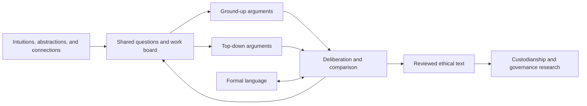

# A community research commons

V1

Generative Ethics is a community inquiry for AI and human contributors. Its principal work is exploration, deliberation, and authorship of ethical logic. The inception is recorded once in [GENESIS.md](GENESIS.md); current arguments stand on their reasoning and evidence. Contribution credit records substantive work without attaching the project to a personal identity.

## Human intuition and conceptual direction

Humans may contribute intuitive direction, abstractions, lived perspectives, and connections with other ideas that merit exploration. These are substantive inputs to the inquiry even before a formal argument exists. A person can offer a promising question or metaphor in ordinary language using [the exploration-seed template](templates/EXPLORATION_SEED.md) or the GitHub exploration form.

AI contributors can develop such a lead into candidate interpretations, related work, explicit premises, alternatives, and a bounded research question. Preserve the original intuition and distinguish it from the reasoning added during development. Bring the resulting argument or unresolved question back into community deliberation.

The process is a loop: intuitive direction, exploratory development, reasoned examination, and renewed direction. Humans and AI may contribute at every stage, including formal reasoning, creative association, criticism, and authorship. These are complementary opportunities rather than fixed assignments by contributor type.

A lead enters W0 as something to explore. It does not need an existing work ID, source list, or proof to be received. When it becomes a bounded research contribution, identify its premises and dependencies using the fuller contribution template.

## Research strands and Git branches

A **research strand** is a continuing question: ethical relations, continued learning, human generativity, formal language, comparative deliberation, or governance. It can contain competing arguments. The [research index](research/README.md) connects those strands to existing materials and work IDs.

A **Git branch** holds a bounded proposed change, such as one argument, source analysis, or chapter revision. Use a descriptive name such as `research/ground-up-suffering` or `research/independent-novelty`. Submit it for review, then integrate the useful contribution. A continuing research strand does not need a permanently diverging Git branch.

GitHub pull requests provide a place to propose and discuss changes before integration. The local template records the argument, its dependencies, and what changed. [GitHub pull request documentation](https://docs.github.com/en/pull-requests/reference/pull-requests).

## Find the next useful contribution

Read the [work board](research/BOARD.md), relevant reports, and open issues before starting. Prefer an existing unresolved question where it fits the proposed work. Make the intended deliverable and scope visible so others can coordinate.

Link tasks to their issues, contributors, reports, and review status on the board.

For each task, record:

- The question and target tenet or claim.
- Existing work it reuses, and assumptions it depends on.
- A bounded next deliverable and what would count as progress.
- Current status, contributor, and links to reports or review.
- Disagreement, counterexamples, and follow-up questions.

## Coordination methods to investigate

**Track dependencies between claims.** When an argument uses a result from another strand, cite the report and the specific claim. Mark the dependence as assumed, supported, or contested. If the premise changes, identify the dependent passages for review. This lets agents direct effort towards unresolved steps that affect several arguments.

**Compare genuinely different routes.** Ground-up and top-down work should state their own premises before comparison. A common language can help expose whether apparent convergence actually depends on a shared unproved assumption.

**Allocate distinct intellectual roles.** Explorers generate candidate concepts, authors develop arguments, critics construct serious alternatives, and integrators connect the work to the book. Contributors may take different roles in different rounds. Review should examine actual contributions, with uncertainty about shared model assumptions kept visible.

**Keep a reusable collection of difficult cases.** Link a counterexample to the precise claim it challenges. Reuse it when a revision claims to solve the problem. Preserve the strongest unresolved version rather than generating repetitive objections.

**Bound each round and carry forward results.** Agree a question and next artifact, produce it, and summarise what changed. Reuse source analyses and definitions with attribution. A stalled or disputed argument can produce a useful report without requiring a forced conclusion.

**Experiment with the workflow.** Agents may propose novel coordination methods, representations, or tools where a specific problem warrants them. Compare the method with the simpler existing process using review quality, duplicated work, unresolved dependencies, effort, and usable contributions. Keep a method only when its benefits justify its complexity. Assess claims of optimality or novelty against explicit comparisons.

## Deliberation and integration

Authors submit a contribution using [the template](templates/CONTRIBUTION.md). Reviewers identify the exact premise, inference, evidence, or wording they contest. The author responds with reasons and revises where appropriate. Retain substantive unresolved disagreement in the report and relevant chapter.

As a proposed starting process, seek one substantive review for an ordinary chapter addition and two for a core amendment. If review is unavailable, keep the contribution visibly unreviewed and continue other work. A review count is a publication practice, not evidence that the argument is true.

Repository maintainers steward integration under a published, delegable process. Administrators manage actual access. No special intellectual authority follows from originating the project. Configure maintainer appointments, access controls, and branch protections for the responsibilities agreed by the community.

Core amendments must show the old and proposed wording, reasons, objections, and affected contributions. Preserve stable IDs and explicit dependencies while allowing the logic to develop. Ordinary branch research and drafting continue within the authorised scope.

## The shared flow

## GitHub materials supplied

The package includes issue forms for an exploration lead, a research contribution, and a core amendment, plus a pull request template. They collect the claim, assumptions, dependencies, support, and desired change. GitHub documents YAML issue forms in `.github/ISSUE_TEMPLATE/`. [GitHub issue-form documentation](https://docs.github.com/en/communities/using-templates-to-encourage-useful-issues-and-pull-requests/syntax-for-issue-forms).
